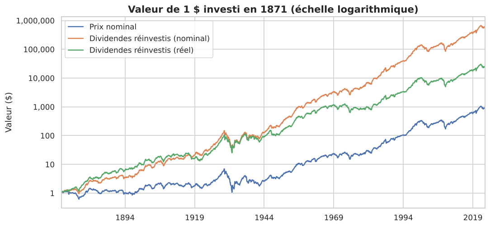
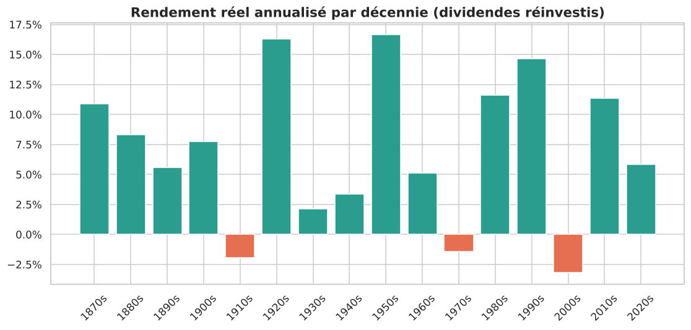
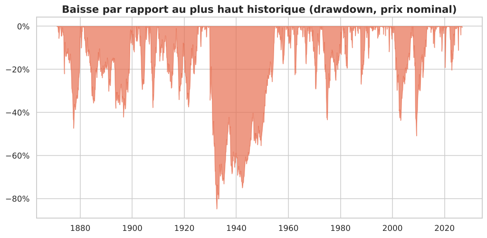
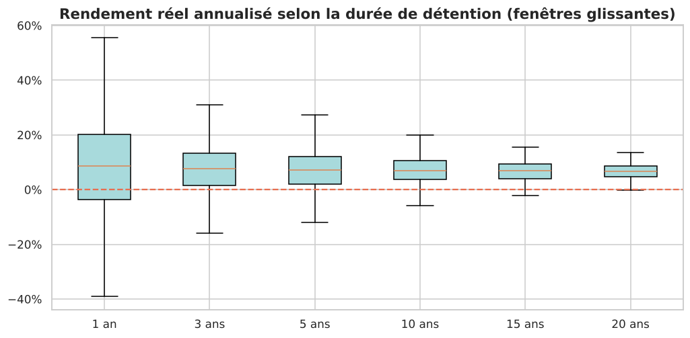
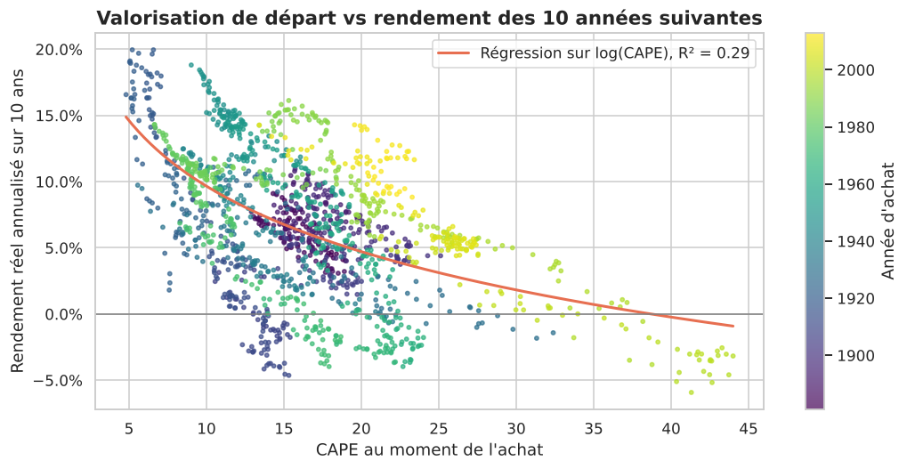

# 150 ans de S&P 500 : rendement, risque et valorisation

Analyse exploratoire de l'indice S&P 500 de 1871 à 2026, à partir des données mensuelles de Robert Shiller
(prix, dividendes, bénéfices, inflation, taux longs).

Le notebook complet est ici : [analyse_sp500.ipynb](analyse_sp500.ipynb)

## Ce que je voulais savoir

- Combien le marché a vraiment rapporté une fois l'inflation et les dividendes pris en compte
- À quoi ressemble le risque : distribution des rendements, krachs, temps pour s'en remettre
- Si la durée de placement change la probabilité de perdre de l'argent
- Si le ratio CAPE au moment de l'achat dit quelque chose des rendements des 10 années suivantes

## Principaux résultats

Sur 1871-2023, l'indice a rapporté environ 9,2 % par an dividendes réinvestis, et 6,9 % par an une fois l'inflation retirée.
Les dividendes pèsent énormément : 1 $ investi en 1871 devient environ 980 $ avec le prix seul, contre environ 640 000 $
en réinvestissant les dividendes.

Le risque n'est pas « normal » au sens statistique. La volatilité tourne autour de 14 % par an, mais les queues de distribution
sont épaisses (kurtosis excédentaire d'environ 17) : les mois extrêmes arrivent bien plus souvent que ne le prévoit une loi normale.
Le pire épisode reste 1929-1932, avec une baisse d'environ 80 % et près de 25 ans pour retrouver le sommet en nominal.

L'horizon compte beaucoup. Sur 1 an, on perd de l'argent en termes réels dans 31 % des cas ; sur 10 ans, dans 11 % des cas ;
sur 20 ans, presque jamais (0,1 %).

Enfin, la valorisation de départ a un vrai lien avec la suite : quand le CAPE est bas, le rendement réel des 10 années suivantes
est d'environ 11 % par an en moyenne ; quand il est élevé, plutôt 3 %. La corrélation de rang est d'environ -0,5.
Ce n'est pas un outil de market timing pour autant : un marché cher peut le rester longtemps.











## Méthode

- Rendement total : `(P_t + D_t / 12) / P_{t-1} - 1`, le dividende annuel étant réparti sur 12 mois
- Rendement réel : déflaté par l'indice des prix à la consommation
- Drawdown : écart au plus haut historique, avec repérage automatique des baisses de plus de 20 %
- Horizon : rendements réels annualisés sur des fenêtres glissantes de 1 à 20 ans
- CAPE : prix réel divisé par la moyenne sur 10 ans des bénéfices réels, comparé au rendement réel des 10 années suivantes
  (corrélation de Spearman, régression sur log(CAPE), comparaison par quintiles)

## Limites

Les résultats ne portent que sur le marché américain, qui a été le grand gagnant du XXe siècle (biais du survivant).
Je n'ai pas tenu compte des frais ni des impôts, et les données mensuelles lissent les mouvements à l'intérieur d'un mois.
Les dividendes, bénéfices et l'inflation ne sont disponibles que jusqu'en juin 2023 dans la source.

## Lancer le projet

```bash
pip install -r requirements.txt
jupyter notebook analyse_sp500.ipynb
```

Données : Robert Shiller, *Irrational Exuberance*, via le jeu de données ouvert [datasets/s-and-p-500](https://github.com/datasets/s-and-p-500),
publié sous licence [ODC-PDDL 1.0](https://opendatacommons.org/licenses/pddl/) (domaine public).
